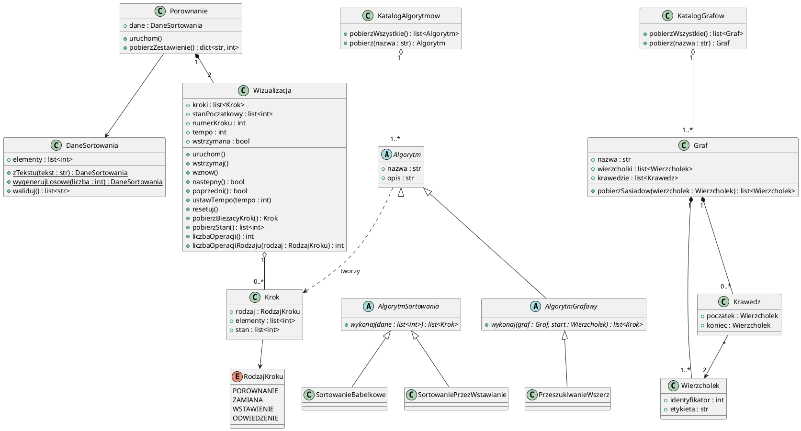

# Diagram klas UML (Unified Modeling Language)

Diagram klas przedstawia klasy systemu, ich atrybuty, metody oraz relacje między nimi. Klasy wynikają z pojęć zdefiniowanych w [słowniku domenowym](glossary.md), a metody z [przypadków użycia](use-cases/README.md).

## Skąd wynikają klasy

| Klasa | Pojęcie ze słownika | Przypadki użycia |
|---|---|---|
| Algorytm, AlgorytmSortowania, AlgorytmGrafowy | Algorytm, Algorytm sortowania, Algorytm grafowy | UC-01, UC-02, UC-04 |
| SortowanieBabelkowe, SortowaniePrzezWstawianie, PrzeszukiwanieWszerz | Sortowanie bąbelkowe, Sortowanie przez wstawianie, Przeszukiwanie wszerz | UC-01, UC-02, UC-04 |
| Krok, RodzajKroku | Krok algorytmu, Liczba operacji | UC-01, UC-02, UC-03 |
| Graf, Wierzcholek, Krawedz | Graf, Wierzchołek, Krawędź | UC-02 |
| DaneSortowania | Dane wejściowe | UC-01, UC-04 |
| Wizualizacja | Wizualizacja, Tempo wizualizacji, Wyróżnienie | UC-01, UC-02, UC-03 |
| Porownanie | Porównanie algorytmów | UC-04 |
| KatalogAlgorytmow, KatalogGrafow | — (lista dostępnych algorytmów i gotowych grafów) | UC-01, UC-02, UC-04 |
