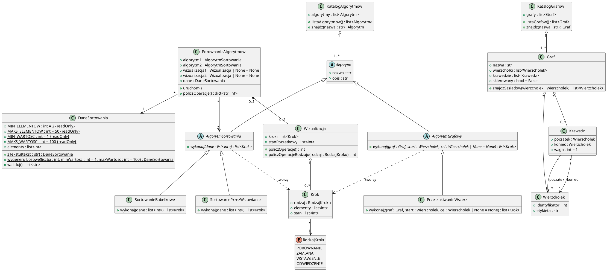

# Diagram klas UML (Unified Modeling Language)

Diagram klas przedstawia klasy systemu, ich atrybuty, metody oraz relacje między nimi. Klasy wynikają z pojęć zdefiniowanych w [słowniku domenowym](glossary.md), a metody z [przypadków użycia](use_cases/README.md).

Python zapisuje stan początkowy i kroki algorytmu oraz zlicza operacje. JavaScript będzie odtwarzał animację, obsługiwał pauzę, tempo i wybór kroku. Aby pokazać licznik przy wybranym kroku, interfejs może zliczyć kroki od początku do tego miejsca.

Porównanie korzysta z dwóch różnych algorytmów sortowania i jednego zestawu danych. Przed uruchomieniem obie wizualizacje mogą być puste (`None`). Po zakończeniu `uruchom()` każdy algorytm ma własną wizualizację, a `policzOperacje()` zwraca liczbę operacji dla każdego z nich.

## Skąd wynikają klasy

| Klasa | Pojęcie ze słownika | Przypadki użycia |
|---|---|---|
| Algorytm, AlgorytmSortowania, AlgorytmGrafowy | Algorytm, Algorytm sortowania, Algorytm grafowy | UC-01, UC-02, UC-04 |
| SortowanieBabelkowe, SortowaniePrzezWstawianie, PrzeszukiwanieWszerz | Sortowanie bąbelkowe, Sortowanie przez wstawianie, Przeszukiwanie wszerz | UC-01, UC-02, UC-04 |
| Krok, RodzajKroku | Krok algorytmu, Liczba operacji | UC-01, UC-02, UC-03 |
| Graf, Wierzcholek, Krawedz | Graf, Wierzchołek, Krawędź | UC-02 |
| DaneSortowania | Dane wejściowe | UC-01, UC-04 |
| Wizualizacja | Wizualizacja, Liczba operacji | UC-01, UC-02, UC-03 |
| PorownanieAlgorytmow | Porównanie algorytmów | UC-04 |
| KatalogAlgorytmow, KatalogGrafow | — (lista dostępnych algorytmów i gotowych grafów) | UC-01, UC-02, UC-04 |
