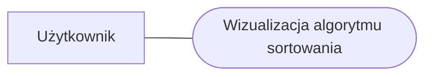
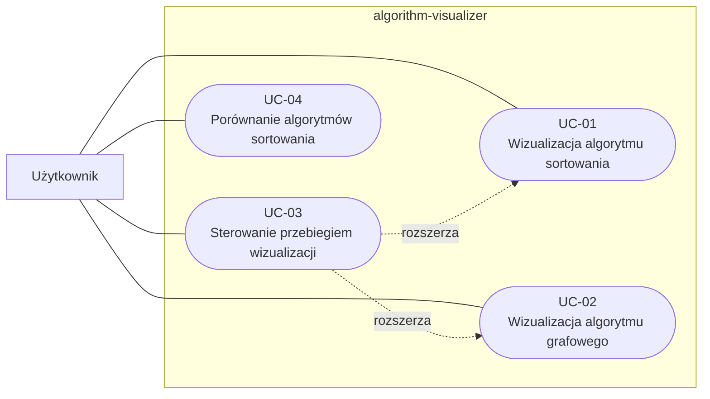
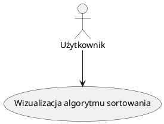
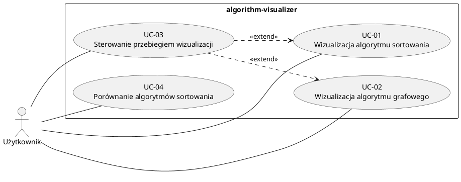

# Przypadki użycia

## Wersja Mermaid

### 1. Aktor i przypadek użycia

### 2. Granice systemu i relacja rozszerzenia

## Wersja PlantUML — zgodna z notacją UML

### 1. Aktor i przypadek użycia

### 2. Granice systemu i relacja rozszerzenia

## Katalog przypadków użycia

| ID | Przypadek użycia | Aktor | Wymagania |
|----|------------------|-------|-----------|
| [UC-01](UC-01-visualize-sorting.md) | Wizualizacja algorytmu sortowania | Użytkownik | FR-01, FR-02, FR-03, FR-04, FR-06, FR-07, FR-08, FR-13, FR-16 |
| [UC-02](UC-02-visualize-graph-algorithm.md) | Wizualizacja algorytmu grafowego | Użytkownik | FR-01, FR-02, FR-05, FR-06, FR-07, FR-08, FR-13 |
| [UC-03](UC-03-control-visualization.md) | Sterowanie przebiegiem wizualizacji | Użytkownik | FR-09, FR-10, FR-11, FR-12 |
| [UC-04](UC-04-compare-sorting.md) | Porównanie algorytmów sortowania | Użytkownik | FR-01, FR-03, FR-04, FR-14, FR-15, FR-16 |